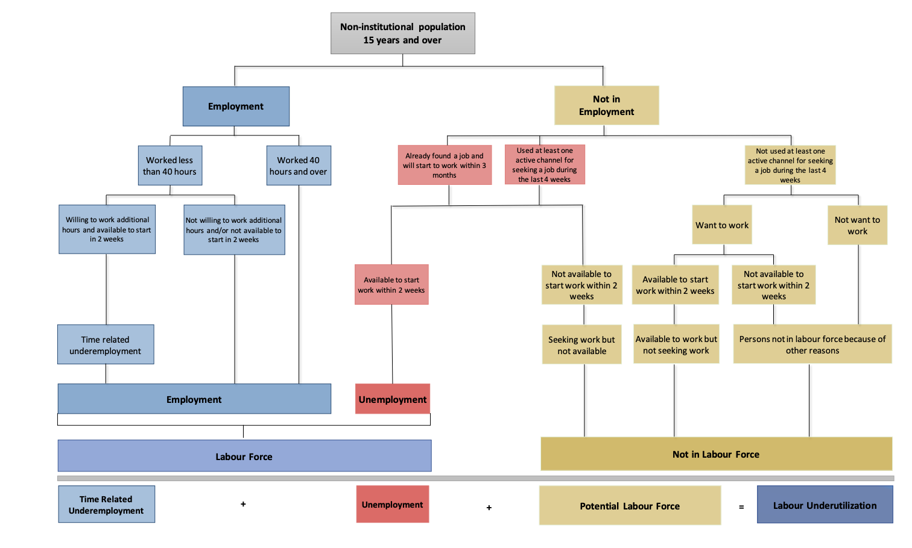

# Labor Status

## ICLS-19

The 19th International Conference of Labour Statisticians (ICLS-19) adopted a resolution on work, employment and labour underutilization in 2013. It defines employment as work performed for pay or profit and treats production for a household's own consumption as a separate form of work. Adopting this definition can introduce a break in a survey's employment series. [ILO resolution](Utilities/icls-19-resolution.pdf)

In 2020, TurkStat added questions on production for own consumption to assess the effect of the new definitions. It still used ICLS-13 to classify employment. The 2020 microdata contain main-job industry and occupation responses for some own-use farmers who counted as employed under that definition. [TurkStat's analysis of the 2020 transition](Utilities/hia_metod_en.pdf#page=9)

TurkStat began applying ICLS-19 in January 2021. The revised definition excludes production for own use from employment and assesses job attachment during temporary absence based on the reason for absence and, where applicable, its duration or continued pay. The change affects comparisons of the 2020 and 2021 microdata. TurkStat published revised headline estimates back to 2005 for comparisons across the break. [TurkStat's methodological note](Utilities/hia_metod_en.pdf#page=4) and [announcement on revised estimates](Utilities/hlfs-revised-estimates.pdf).

## Definition of Unemployed

Under the revised framework, people who were not employed in the reference week generally qualify as unemployed through either of two routes. [TurkStat's 2025 codebook, p. 9](Utilities/hlfs-2025-microdata-codebook.pdf#page=9).

1. They took active steps to find work in the last four weeks and were available to start within two weeks.
2. They had already found work due to start within three months and were available to start within two weeks.

*Source: TurkStat, Household Labour Force Survey explanatory notes, Appendix 2.*

TurkStat provides a derived labour force status in the microdata. In `DURUM`, code `1` identifies the employed and code `2` the unemployed. The codebook directs users to `DURUM = 1` for the employment total and explains that some people who answer yes to the work questions are classified outside employment. Work in the reference week and temporary absence are therefore insufficient to reconstruct every employment classification. The released files checked for the post-2020 rounds also lack a separate indicator for production for own consumption. [TurkStat's 2025 codebook, pp. 15 and 21](Utilities/hlfs-2025-microdata-codebook.pdf#page=15)

In the GLD checks, some people classified as unemployed in `DURUM` could not be assigned to either unemployment route using the released search, availability and future-start responses. They accounted for less than 2% of those classified as unemployed in the records checked. The reasons for these classifications remain unresolved. Weighted estimates based on `DURUM` reproduce the TurkStat and ILOSTAT benchmarks used in the checks, so the GLD uses the derived status for `lstatus` from 2021 onward.
